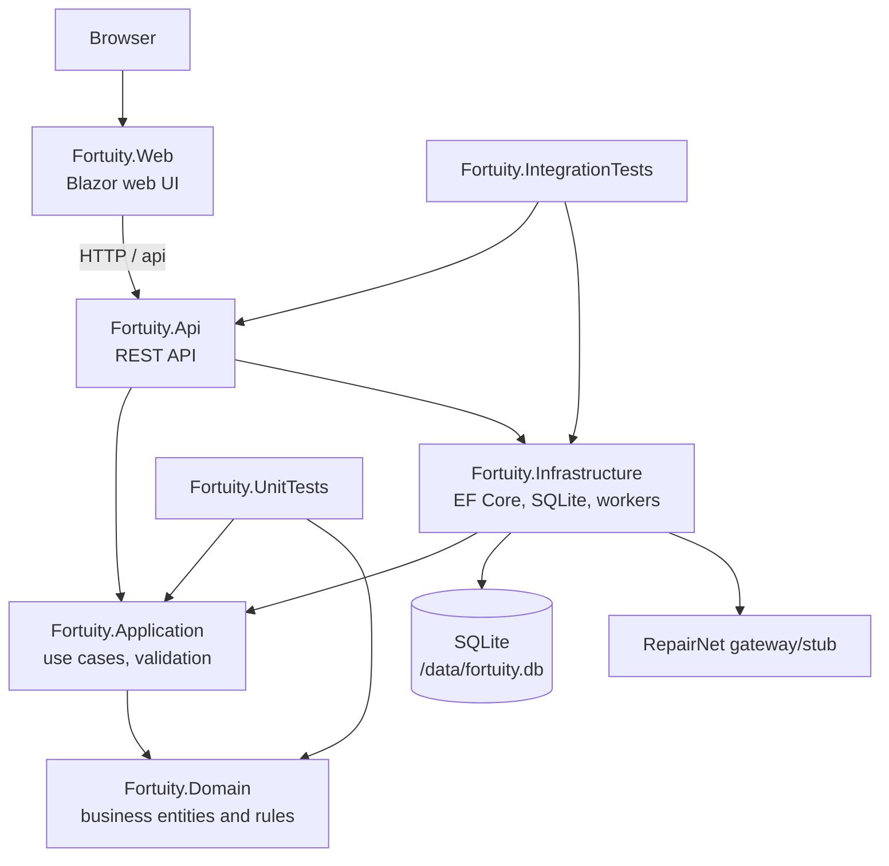

# Fortuity

Fortuity is a small claims and pricing application for a fictional insurance company. It helps claims handlers and customer service staff view customers, calculate insurance quotes, register the first notice of loss (FNOL), and synchronize open claims with repair-shop partners.

The application is also an exercise project: the goal is to explore an unfamiliar .NET solution, get it running, and document it with an AI coding agent. All data is fictional.

## Architecture

The solution contains two runnable ASP.NET Core applications, four library projects, and test projects. Dependencies mostly point inward: the API and Infrastructure use Application, and Application uses Domain.



When the API starts in the Development environment, it applies Entity Framework migrations and adds seed data. `ClaimsSyncWorker` processes synchronization requests in the background through a channel. In the Compose setup, the API listens on container port `8080`, which is published as host port `5015`; the web application calls the API internally at `http://api:8080`.

## Running

Docker Desktop and a working connection to Docker Hub are required. Run this from the repository root:

```powershell
docker compose up --build
```

Endpoints:

- Web UI: [http://localhost:5044](http://localhost:5044/)
- API: [http://localhost:5015](http://localhost:5015/)
- Scalar API reference: [http://localhost:5015/scalar](http://localhost:5015/scalar)
- Health check: [http://localhost:5015/health](http://localhost:5015/health)

Stop the services with:

```powershell
docker compose down
```

The SQLite database is stored in a Docker volume. Remove the volumes as well if you want a fresh database with new migrations and seed data:

```powershell
docker compose down -v
```

## Tests

Tests run in an SDK container, so the .NET SDK is not required on the host machine:

```powershell
docker compose run --rm test
```

The tests cover the health endpoint, seeded customers, Local and Nordic pricing bases, quote creation, and claim registration.

## API Overview

All business endpoints use JSON, and enum values are serialized as strings. Errors are returned as RFC 7807-style `ProblemDetails` responses. The examples below assume that the API is running.

| Method and route | Purpose |
| --- | --- |
| `GET /health` | Returns the service status, for example `{ "status": "ok" }`. |
| `GET /api/customers` | Lists customers. |
| `GET /api/customers/{customerNumber}` | Gets a customer and their policies. |
| `POST /api/quotes` | Creates a quote using the customer's preferred pricing basis. |
| `POST /api/quotes/indication` | Calculates a quick indication for a region and basis (`Local` or `Nordic`). A missing basis defaults to Local. |
| `POST /api/claims` | Registers a new claim and its initial reserve. |
| `GET /api/claims/open` | Lists open claims. |
| `POST /api/claims/sync` | Creates a background RepairNet synchronization request and returns `202 Accepted`. |
| `GET /api/claims/sync/status` | Shows repair-shop partner synchronization status. |

Example quick indication request:

```http
POST http://localhost:5015/api/quotes/indication
Content-Type: application/json

{
	"policyType": "Motor",
	"coverage": "Standard",
	"region": "FI-01",
	"basis": "Nordic",
	"ageYears": 5,
	"noClaimsYears": 5
}
```

The API project file [Fortuity.Api.http](src/Fortuity.Api/Fortuity.Api.http) contains ready-made requests for the main use cases.

## Notes for New Developers

- **The Development setting is important at startup.** The Dockerfile sets `ASPNETCORE_ENVIRONMENT=Development` for both the API and web applications. In this mode, the API automatically applies migrations, seeds the database, and exposes the Scalar API reference. This assumption should not be copied directly into production.
- **The data is not just temporary container data.** The API's SQLite file is `/data/fortuity.db` and is stored in the `fortuity-data` volume. `docker compose down` does not clear the data; `down -v` does.
- **No authentication or authorization checks are visible.** All API routes are locally open. That is acceptable for an exercise project, but production use requires at least identity, authorization, secret management, and transport security.
- **Synchronization is asynchronous and partially failure-tolerant.** `POST /api/claims/sync` acknowledges the request before all shops have been processed. An HTTP or timeout failure for one shop is recorded as `Failed` and processing continues for other shops; no retry mechanism is visible in the implementation.
- **RepairNet is a stub in this solution.** The API default is `http://localhost:5015`, while the Docker configuration points it to port `8080` inside the API container. A real partner integration would need an environment-specific URL and an external system contract.
- **Money formatting depends on the runtime environment.** The project explicitly supports `fi-FI` formatting and therefore uses Debian-based .NET runtime images instead of Alpine images. The globalization setting should not be changed casually.
- **Seed data and numbering are part of the expected test state.** Integration tests expect six seeded customers and specific pricing values. Persisting the database between test runs can change the starting state, so tests should run in their isolated container or with a clean volume.

## Project Boundaries

- `Fortuity.Domain`: business models and value objects without infrastructure dependencies.
- `Fortuity.Application`: use cases, validation, and abstractions for persistence and external services.
- `Fortuity.Infrastructure`: EF Core persistence, SQLite, seed data, auditing, and background partner synchronization.
- `Fortuity.Api`: HTTP contract, controllers, OpenAPI, and Scalar.
- `Fortuity.Web`: browser UI that calls the API.
- `Fortuity.UnitTests` and `Fortuity.IntegrationTests`: unit and API-level tests.
